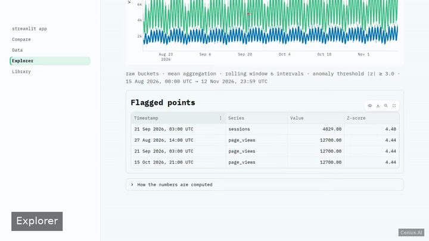
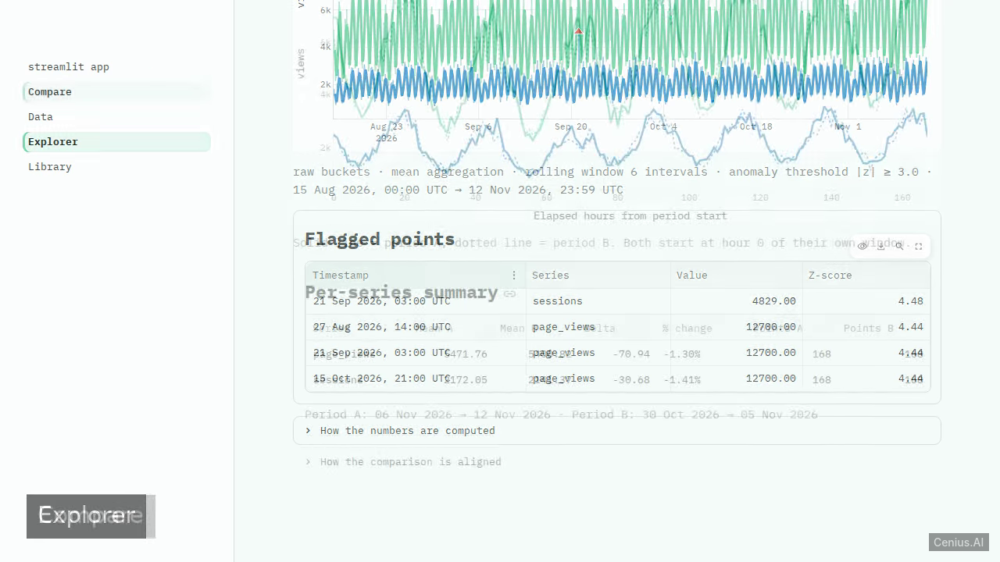
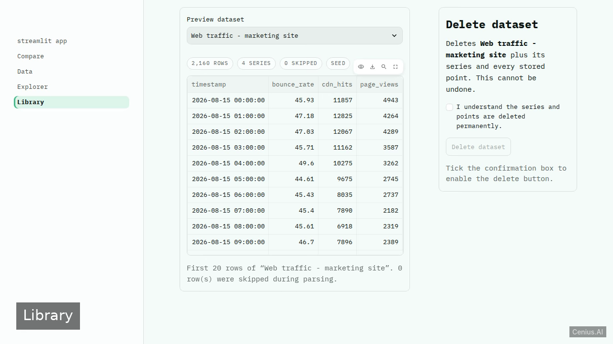

# Metricscope Time-Series Explorer — complete Full-stack app monitoring dashboard example app

Need a self-hosted monitoring dashboard? **Metricscope Time-Series Explorer** is the open-source answer: a Full-stack app project you can clone, run, and own. Metricscope is a Grafana-lite explorer for CSV time-series metrics, built as a Streamlit multi-page app (root streamlit_app.py + pages/) backed by a single local SQLite file. Every Metricscope Time-Series Explorer line of code is here — no stripped demo, no paywalled features. Apache-2.0-licensed; [remix Metricscope Time-Series Explorer on cenius.ai](https://cenius.ai/marketplace/p/metricscope-time-series-explorer?ref=gh&utm_campaign=metricscope-time-series-explorer-webapp) for a bespoke custom version.


[](LICENSE)  [](https://cenius.ai)

[](https://cenius.ai/marketplace/p/metricscope-time-series-explorer?ref=gh&utm_campaign=metricscope-time-series-explorer-webapp)

> **▶ [Open & edit in cenius.ai](https://cenius.ai/marketplace/p/metricscope-time-series-explorer?ref=gh&utm_campaign=metricscope-time-series-explorer-webapp)** — one click to an editable workspace: describe changes in plain English, get an instant preview, one-click deploy and host. Modifications made on the platform come with full rebrand & relicense rights.

_Local clone? See [Quick start](#quick-start) below. cenius.ai is the zero-setup path._

## Demo



▶ **[See it in action](https://cenius.ai/marketplace/p/metricscope-time-series-explorer?ref=gh&utm_campaign=metricscope-time-series-explorer-webapp)** — full demo on the project page · [MP4](.github/media/demo.mp4)

## Screenshots

  

## Architecture

Full-stack app project, delivered as a complete runnable codebase (65 files). Top-level layout: `data/`, `pages/`, `scripts/`, `src/`, `static/`, `tests/`. The setup script (`install.sh`) installs runtime dependencies and loads a starter dataset so the app is immediately usable. Full setup details: [`INSTALL.md`](INSTALL.md).

## Features

- Local sign-in gate
- Curated seed datasets
- CSV upload with validation
- Dataset library management
- Multi-series plotting on the Explorer
- Rolling average and resampling controls
- Z-score anomaly highlighting
- Two-period date-range comparison
- Clean and minimal presentation

## Quick start

```bash
./install.sh   # installs dependencies + seeds demo data
```

See [`INSTALL.md`](INSTALL.md) for full setup and usage instructions.

## Usage guide

### Overview

This is **Metricscope Time-Series Explorer** — an importable library / package. This document covers the surface area you can use, with copy-pasteable examples for each entry point. For setup, see `INSTALL.md`.

### Quickstart

```python
## After `pip install this-package`:
import this_package

## Inspect the public API:
print(dir(this_package))
```

### Public API

**65** public symbols were detected at the library surface.

| Symbol | Source |
|--------|--------|
| `flag_frame` | `src/anomaly.py` |
| `flag_mask` | `src/anomaly.py` |
| `summarise` | `src/anomaly.py` |
| `zscores` | `src/anomaly.py` |
| `auth` | `src/api/__init__.py` |
| `compare` | `src/api/__init__.py` |
| `datasets` | `src/api/__init__.py` |
| `query` | `src/api/__init__.py` |
| `upload` | `src/api/__init__.py` |
| `AuthError` | `src/auth.py` |
| `authenticate` | `src/auth.py` |
| `create_session` | `src/auth.py` |
| `create_user` | `src/auth.py` |
| `hash_password` | `src/auth.py` |
| `normalise_identifier` | `src/auth.py` |
| `revoke_session` | `src/auth.py` |
| `session_user` | `src/auth.py` |
| `verify_password` | `src/auth.py` |
| `connect` | `src/db.py` |
| `connection` | `src/db.py` |
| `count` | `src/db.py` |
| `get_conn` | `src/db.py` |
| `init_db` | `src/db.py` |
| `iso` | `src/db.py` |
| `tables` | `src/db.py` |
| `utcnow` | `src/db.py` |
| `ParsedUpload` | `src/ingest.py` |
| `UploadError` | `src/ingest.py` |
| `dataset_name_from_filename` | `src/ingest.py` |
| `iter_points` | `src/ingest.py` |

_… and 35 more (truncated)._

#### Import examples

_Full guide: [`USAGE.md`](USAGE.md)_

## FAQ

### What's the quickest way to self-host Metricscope Time-Series Explorer?

Clone this repository and run `./install.sh`, then start the app as described in [`INSTALL.md`](INSTALL.md). Metricscope Time-Series Explorer is fully self-hostable — no external services are required to try it.

### Is there a no-code way to modify Metricscope Time-Series Explorer?

Non-developers can use [cenius.ai](https://cenius.ai/marketplace/p/metricscope-time-series-explorer?ref=gh&utm_campaign=metricscope-time-series-explorer-webapp) to make changes. Describe your goal in everyday language and the platform delivers an updated, ready-to-run project — zero coding on your part.

### What is Metricscope Time-Series Explorer built with?

Full-stack app end-to-end. Every file you need to run the app is here in this repository — code, configuration, seed data. Highlights include dataset library management.

### Is Metricscope Time-Series Explorer free for commercial use?

Yes — Apache-2.0-licensed, so commercial use, modification, and distribution are all permitted. Read the full terms in [LICENSE](LICENSE).

### How do I customise Metricscope Time-Series Explorer's branding?

Yes. You can edit the source directly under the MIT license, or [remix it on cenius.ai](https://cenius.ai/marketplace/p/metricscope-time-series-explorer?ref=gh&utm_campaign=metricscope-time-series-explorer-webapp) — the platform route grants full rebrand and relicense rights over your derivative.

## License & rebranding

Released under the [Apache License 2.0](LICENSE) (© 2026 Cenius AI) — free for personal and commercial use. The Cenius name/logo are trademarks (see NOTICE).

**Need a customized version?** [Remix this app on cenius.ai](https://cenius.ai/marketplace/p/metricscope-time-series-explorer?ref=gh&utm_campaign=metricscope-time-series-explorer-webapp) — modifications made on the platform come with **full rebrand & relicense rights** over your derivative.

## Built with cenius.ai

This entire application — code, design, seeded demo data — was generated on **[cenius.ai](https://cenius.ai)** from a plain-English description.

- 🚀 [Build your own app on cenius.ai](https://cenius.ai)
- 🎛️ [Remix Metricscope Time-Series Explorer on the marketplace](https://cenius.ai/marketplace/p/metricscope-time-series-explorer?ref=gh&utm_campaign=metricscope-time-series-explorer-webapp) — open it in a workspace, prompt for changes, and ship your own version.

More open-source apps: [the Cenius-ai catalog](https://github.com/Cenius-ai) · [showcase index](https://github.com/Cenius-ai/showcase)
